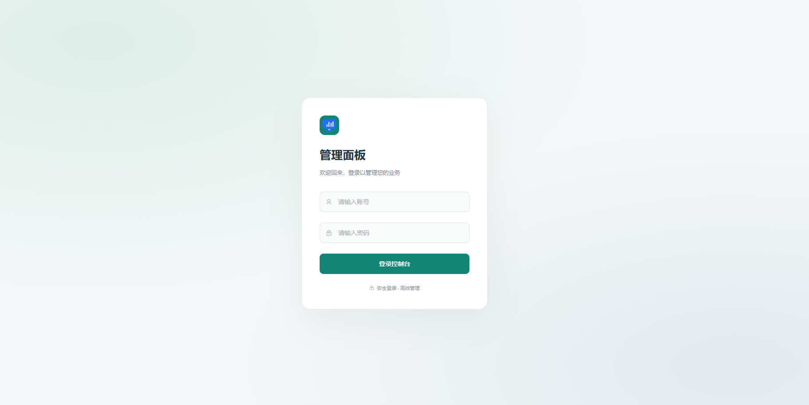
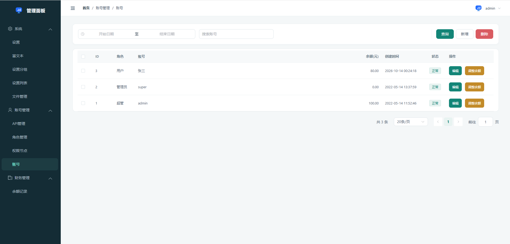
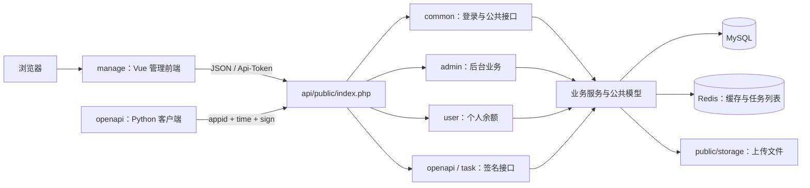
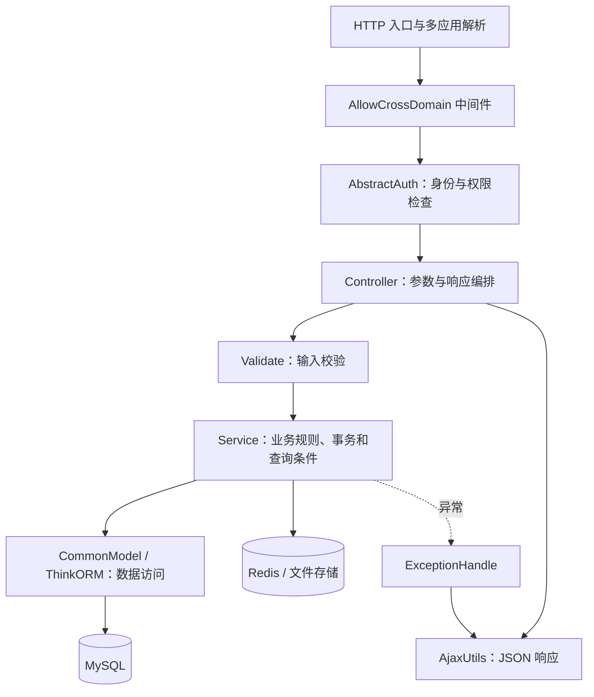

# ElementPlus-TP8

基于 Vue 3、Element Plus 和 ThinkPHP 8 的通用后台管理系统。仓库包含独立构建的管理前端、提供 HTTP 接口的 PHP 后端，以及用于对接任务接口的 Python 客户端示例。

本文依据当前仓库代码整理；依赖的实际安装版本以 `manage/package-lock.json` 和 `api/composer.lock` 为准。

## 默认超级管理员

导入 `api/dbdata.sql` 后，可使用以下初始凭据登录：

- 账号：`admin`
- 密码：`123456`

首次登录后请修改密码。

## 界面预览

### 登录面板



### 主面板



## 整体架构



前端以单页应用运行，通过 Axios 调用后端接口；后端采用 ThinkPHP 多应用模式，共享业务模型、鉴权基类和公共服务。Python 客户端直接访问签名接口。项目使用 HTTP 通信，没有 WebSocket 服务。

注意两个同名目录的区别：仓库根目录的 `openapi/` 是 Python 客户端，`api/app/openapi/` 是 PHP 后端的开放接口应用。

## 仓库结构

```text
ElementPlus-TP8/
├── manage/                         管理前端
│   ├── src/
│   │   ├── main.js                 Vue、Pinia、Router 和全局样式入口
│   │   ├── App.vue                 中文组件配置与路由出口
│   │   ├── router/                 静态路由、权限路由映射及登录守卫
│   │   ├── layouts/                侧栏、顶部栏、面包屑与内容区
│   │   ├── views/                  登录、控制台、账号、系统、个人页面
│   │   ├── api/                    按业务模块封装接口
│   │   ├── store/modules/          用户、权限路由及站点信息缓存
│   │   ├── composables/            列表、请求缓存和交易类型复用逻辑
│   │   ├── components/             表单弹窗、分页、上传、富文本
│   │   ├── utils/                  Axios、接口工厂、Token、格式化工具
│   │   └── styles/                 重置、查询表单与主题样式
│   ├── public/tinymce/             本地加载的 TinyMCE 静态资源
│   ├── scripts/setup-git-hooks.mjs Git 钩子安装脚本
│   └── vite.config.mjs             开发、按需导入、别名及打包配置
├── api/                            ThinkPHP 后端
│   ├── public/index.php            HTTP 入口；Web 站点根目录为 public
│   ├── app/
│   │   ├── admin/                  后台控制器、服务和验证器
│   │   ├── common/                 公共接口、基类、服务、模型及工具
│   │   ├── user/                   当前账号余额与流水接口
│   │   ├── openapi/                开放接口连通性检查
│   │   ├── task/                   任务领取、上报入口与 Redis 队列服务
│   │   ├── middleware.php          全局 CORS 中间件注册
│   │   └── ExceptionHandle.php     业务异常及系统异常响应
│   ├── config/                     数据库、缓存、JWT、上传等配置
│   ├── route/app.php               路由入口，当前未声明自定义路由
│   ├── runtime/                    运行数据、日志和自动生成的 JWT 密钥
│   ├── dbdata.sql                  数据库结构与种子数据
│   └── .example.env                后端环境变量模板
├── openapi/                        Python 签名客户端示例
│   ├── modules/api.py              环境配置、签名、requests 请求和任务接口
│   ├── test_order.py               持续轮询与上报示例，并非自动化测试
│   ├── requirements.txt            requests 依赖
│   └── .env.example                客户端环境变量模板
└── .github/workflows/ci.yml         前端、PHP 与 Python 检查
```

## 前端架构

### 技术与构建

前端采用 JavaScript、Vue 3 Composition API、Vue Router 4、Pinia 3、Element Plus 2、Axios 和 VueUse，使用 Vite 8 构建，Sass 编译样式。没有 TypeScript 编译流程。

- `main.js` 注册 Pinia 和 Router，挂载 `App.vue`，通过 `VITE_APP_TITLE` 设置标签页标题。
- `vite.config.mjs` 使用 `unplugin-auto-import` 自动导入 Vue、Router、Pinia API，并通过 `unplugin-vue-components` 按需加载 Element Plus 组件与样式。
- `@` 指向 `manage/src`，另有 `components`、`views`、`utils` 别名；编辑器映射见 `manage/jsconfig.json`。
- 开发服务监听 `0.0.0.0:3000`，当前没有配置 Vite 接口代理，浏览器直接请求 `VITE_API_BASE_URL`。
- 构建使用相对资源基址 `./`，输出到 `manage/dist`，关闭 source map，并按依赖拆包。
- `optimizeDeps.include` 会扫描 Element Plus 样式入口，避免按需加载时反复预构建并刷新页面，应保留该配置。

### 路由、菜单与状态

`src/router/index.js` 使用 Hash 路由。控制台、登录、修改密码及 404 为静态路由，其余业务路由通过后端权限数据动态注册。

1. 登录页调用 `/common/overt/login`，成功后将 Token 保存到 `localStorage.token`。
2. 路由守卫检测 Token，首次进入时通过用户 Store 请求 `/common/account/getRoutes`。
3. `src/router/routes.js` 将后端返回的路径树映射到本地 `routesMap`，为页面绑定懒加载组件；未登记的路径会被跳过。
4. Router 动态注册路由，布局组件使用同一映射生成侧栏菜单。
5. 退出或登录态失效时清除 Token 并整页刷新，使下次登录重新注册权限路由。

`store/modules/user.js` 管理用户信息和权限路由缓存，`overt.js` 缓存站点初始化信息。两者复用 `useFetchCache`，缓存存在内存中；登录 Token 单独持久化。菜单可见性不能代替接口鉴权，最终访问控制由后端执行。

### 请求与页面复用

页面调用链为 `views → api 模块 → createApi / BaseApi → request.js → 后端`。

`src/utils/request.js` 配置 10 秒超时、自动携带 `Api-Token`，并为 GET 请求添加时间戳。响应拦截器在 `code === 1` 时返回 `data`；`code === -10001` 时清理登录态并跳转；其他业务错误展示 `msg`，没有业务信封的网络错误显示网络异常。

`src/utils/baseApi.js` 提供 `createApi(接口前缀, 扩展方法)`，公共方法包括 `getItems`、`add`、`edit`、`del` 和 `getOptions`。各接口文件按 `admin`、`user` 和公共账号功能组织。

- `useTableList`：复用查询、分页、加载状态及批量删除，列表返回值为 `{ items, count, extend? }`；忽略过时请求结果，避免覆盖新查询。
- `useFetchCache`：供 Store 复用请求结果缓存与重复请求等待逻辑。
- `useBalanceTypes`：读取后端交易类型选项。
- `FormDialog`：由 `fields` 配置生成表单，内部维护模型副本，通过 `submit` 回传数据。
- `CrudPagination`：统一列表分页交互。
- `InputUpload`、`Tinymce/Simple.vue`：复用账号上传接口；TinyMCE 从 `public/tinymce` 加载。

### 业务页面

- 账号管理：账号、角色、权限节点、APPID 应用和密钥管理。
- 系统管理：设置、设置分组、设置列表、附件和富文本内容。
- 财务管理：管理员查询余额流水，账号页面执行余额调整。
- 个人中心：查看自己的余额、流水和修改密码。
- 控制台与登录页：站点初始化、公告、验证码及登录交互。

## 后端架构

### 框架入口与应用划分

后端依赖 ThinkPHP 8，锁文件当前锁定框架 `8.1.4`，配套 ThinkORM 3、think-multi-app 1.1、think-filesystem 3、think-captcha 3 和 firebase/php-jwt 7；开发依赖包含 think-trace 2。

HTTP 请求由 `api/public/index.php` 加载 Composer 自动加载器并启动框架。`config/app.php` 默认应用为 `openapi`；当前未强制匹配显式路由，业务接口主要按 `/应用/控制器/方法` 访问，例如 `/admin/member/items`。

- `common`：`Overt` 提供站点初始化、验证码、登录；`Account` 提供账号信息、退出、改密、公告、上传及权限路由。
- `admin`：账号、角色、角色授权、权限节点、APPID、配置、附件、富文本及余额流水管理。
- `user`：当前登录账号的余额和流水查询，服务端限制只能读取自己的记录。
- `openapi`：签名鉴权后的连通性接口 `/openapi/index/ping`。
- `task`：签名鉴权后的任务领取和结果上报入口。

### 分层与请求链路



`app/common/basics/CrudController.php` 继承 JWT 鉴权基类，提供 `items/add/edit/del/getOptions` 流程，以及 `beforeAdd/beforeEdit` 扩展点。具体控制器绑定自己的 Service、Validate 和 Model，也可覆盖公共方法。

`app/common/basics/Service.php` 提供查询条件构造及 CRUD 方法占位，具体业务在子类实现。`app/common/model/CommonModel.php` 继承 ThinkORM Model，统一按 ID 读取及模型字段列表；业务模型集中在 `app/common/model`，供多个应用共享。

全局 `AllowCrossDomain` 处理 Origin 白名单和 OPTIONS 预检。身份与权限检查在控制器基类中执行，公开方法通过显式免登录名单放行。

### 登录与权限模型

两种身份来源共用 `AbstractAuth` 的账号状态与角色权限检查：

- `Auth`：读取请求头 `Api-Token`，由 `LoginService` 校验 JWT，再读取当前账号。
- `Api`：由 `AppSignService` 校验 `appid + time + sign`，再读取 APPID 绑定的账号；仅允许 `openapi`、`task` 应用。

JWT 使用 HS256，默认有效期 7 天，密钥至少 32 字节。退出时缓存 Token 黑名单，修改密码时更新账号的密码版本标记；验证码答案、密码错误计数及临时锁定也依赖缓存。验证码返回 `key + base64`，不依赖 Session cookie。连续 5 次密码错误会触发 15 分钟锁定。

权限关系是「账号 → 单个角色 → 多个权限节点」：`dt_user.type` 对应 `dt_roles.type`，`dt_role_perms` 保存角色与权限节点的多对多关系。账号 ID 为 `1` 时跳过接口权限检查；菜单仍由角色授权生成。

权限节点 `dt_perms` 包含四种类型：

- `group`：组织菜单目录。
- `page`：绑定前端已登记的 `route_path`。
- `action`：绑定后台的模块、控制器与方法。
- `api`：绑定开放接口的模块、控制器与方法。

`PermsAccessService` 分别生成菜单树与接口权限集合。接口按 `module.controller.action` 精确匹配，处理器及权限标识区分大小写；节点或祖先被禁用后不会进入有效权限集合。`permission_key` 保存稳定标识，不能用页面授权代替操作接口授权。APPID 的权限来自绑定账号的角色，没有独立 APPID 授权表。

「生成 CURD」会为页面所配置的控制器补齐已经存在的列表、新增、编辑和删除权限节点，不会生成前后端业务源码。

### 数据、缓存与文件

数据库定义以 `api/dbdata.sql` 为准，使用 MySQL、InnoDB、`utf8mb4` 和默认表前缀 `dt_`。当前主要数据关系如下：

- `dt_user`、`dt_roles`、`dt_role_perms`、`dt_perms`：账号与权限；权限树通过 `parent_id` 组织。
- `dt_app_list.uid` 关联账号：保存 APPID、签名密钥和状态。
- `dt_balance_log.user_id` 关联账号：记录余额变动、变动后余额、类型和操作员。
- `dt_config.group_id` 关联 `dt_config_group`：配置项及分组；`dt_editor` 保存富文本内容。
- `dt_upload` 保存附件元数据；`dt_login_log` 保存登录日志。

上述关系主要由业务代码维护，SQL 未声明外键。删除服务负责引用检查和关联清理；账号删除额外通过 `UserDeleteGuard` 检查余额与流水，可注册闭包扩展规则。自动时间戳关闭，业务代码写入时间字段；部分接口将时间格式化后返回。

余额以整数「分」存储。`BalanceService::change()` 在事务中使用行锁，更新账号余额并写入流水，拒绝余额为负及非法交易类型。交易类型字典唯一来源为 `BalanceService::$typeMap`，流水中的 `type` 存储类型代码；前端通过 `types` 接口读取名称与选项，金额展示使用 `formatFen`。流水修正应新增冲正记录。

默认缓存驱动为 Redis，连接参数在 `api/config/cache.php` 中配置。`CacheUtils` 为配置、权限等业务数据提供标签缓存，在调试模式下跳过这类缓存；登录、验证码和任务直接使用缓存服务，仍需要对应驱动可用。

上传由 `UploadService` 校验扩展名、MIME、大小和图片有效性，使用 public 磁盘写入 `api/public/storage/uploads`，保存 `dt_upload` 记录；数据库写入失败会尝试删除文件。访问路径为 `/storage/...`，配置见 `config/upload.php` 和 `config/filesystem.php`。

## 开放接口与 Python 客户端

后端 `AppSignService` 校验请求时间与服务器时间偏差不超过 60 秒，检查 APPID 状态并比对签名。签名按参数键排序，排除 `sign`，将非空参数拼接为 `key=value&...`，追加 `&secret=密钥` 后计算 MD5；PHP 空值规则会排除字符串 `"0"`，对接时需保持一致。

`openapi/modules/api.py` 直接使用 `requests` 发送请求、解析 JSON，提供 `getTask()` 和 `setReport()`。GET 使用查询参数，POST 使用表单数据，均携带签名并设置 10 秒超时；HTTP、网络或 JSON 错误打印原因并返回 `None`。当前客户端没有自动重试；Python 签名实现直接拼接传入值，扩展空值、零值或复杂参数时需对齐上述后端规则。

任务链路为：业务调用 `TaskService::push()` → Redis 列表 `redis_task_list` → `/task/api/getTask` 弹出任务 → Python 执行 → `/task/api/setReport` 上报。队列采用 `rPush/lPop`，领取时跳过过期任务。当前仓库没有自动投递入口，`setReport` 仅读取参数并返回成功，尚未持久化结果，也没有任务确认和失败重入机制。

`test_order.py` 是持续轮询示例，收到任务后等待 3 秒模拟执行，再上报「执行完成」，每轮间隔 1 秒，按 `Ctrl+C` 退出。JSON 数据直接使用 Python 字典读取。

## 接口约定

业务 JSON 接口由 `AjaxUtils` 返回统一信封：

```json
{ "code": 1, "msg": "获取成功", "data": {} }
```

- 成功：HTTP 200，`code = 1`。
- 未登录或登录失效：HTTP 401，`code = -10001`。
- 无权限：HTTP 403，`code = -10002`。
- 参数或业务错误：通常 HTTP 422，`code = -1`。
- 未预期的系统异常：HTTP 500，`code = -1`；非调试环境返回通用错误提示。

控制器直接调用 `AjaxUtils::error()` 时默认仍返回 HTTP 200，因此客户端同时检查业务 `code`。上述 401/403/422/500 主要由异常处理器映射。

列表通常接收 `page`、`pagesize`，返回 `data.items` 和 `data.count`；树形权限等接口返回专用结构。框架 HTTP 异常沿用框架响应，`/openapi/index/index` 返回字符串，客户端不应假定任意路径都返回上述信封。

## 环境与本地运行

### 环境要求

- PHP 8.2+，CLI 与 Web 服务均需满足；使用 Composer 安装锁定依赖。
- PHP 扩展包括 `ctype`、`curl`、`fileinfo`、`gd`（含 FreeType）、`mbstring`、`pdo_mysql`；默认缓存及任务还需要 Redis 扩展和 Redis 服务。
- MySQL：使用兼容 `api/dbdata.sql` 的版本，连接字符集保持 `utf8mb4`。
- Node.js：建议使用 22.x（至少 22.13）或 24+，同时满足 Vite 8 和 ESLint 10 的引擎要求。
- Python 3.9+：仅运行 Python 客户端时需要。

### 后端安装

在仓库根目录执行：

```bash
cd api
composer install
cp .example.env .env
composer check-platform-reqs
```

Windows PowerShell 可用 `Copy-Item .example.env .env` 复制模板。修改 `.env`：

- `APP_DEBUG`：生产使用 `false`。
- `[DATABASE]`：设置 `HOSTNAME/DATABASE/USERNAME/PASSWORD/HOSTPORT`，`CHARSET` 使用 `utf8mb4`。
- `[JWT] SECRET`：替换模板值，设置至少 32 字节的固定随机密钥；留空时自动生成到 `api/runtime/jwt_key`。
- `[CORS] ALLOW_ORIGINS`：逗号分隔允许的前端 Origin；本地默认开发地址为 `http://localhost:3000`。留空会回显请求 Origin，生产应明确配置白名单。

默认 Redis 连接为 `127.0.0.1:6379`、空密码，按环境修改 `config/cache.php`；任务模块明确访问 Redis，即使默认缓存切换为文件也仍需要 Redis。

为新环境创建空数据库并导入种子数据。以下命令使用 Bash 或支持输入重定向的命令行；PowerShell 可通过数据库客户端执行 SQL 文件：

```bash
mysql -uroot -p -e "CREATE DATABASE dbdata DEFAULT CHARACTER SET utf8mb4 COLLATE utf8mb4_general_ci;"
mysql -uroot -p dbdata < dbdata.sql
```

`dbdata.sql` 包含删表重建语句，只用于初始化；已有数据库应先备份并人工比对结构。当前仓库未提供 `db/migrations` 增量脚本。

将 Web 站点根目录设置为 `api/public`，配置不存在的路径转发到 `index.php` 并保留 PATH_INFO。可将本地 hosts 中的 `admin.test.com` 指向 `127.0.0.1`，与前端开发配置对应。初始化后的登录凭据见「默认超级管理员」。

### 前端运行

在仓库根目录执行：

```bash
cd manage
npm ci
npm run dev
```

默认访问 `http://localhost:3000`。`manage/.env.development` 中 `VITE_API_BASE_URL` 默认为 `http://admin.test.com`；修改接口地址后重启开发服务。`VITE_APP_TITLE` 控制标签页标题。

`npm ci` 或 `npm install` 的 prepare 脚本会将本地 Git 的 `core.hooksPath` 设置为 `manage/.husky`，提交时由 lint-staged 检查暂存文件；CI 环境跳过安装钩子。

### Python 客户端运行（可选）

```bash
cd openapi
python -m pip install -r requirements.txt
cp .env.example .env
python test_order.py
```

运行前填写 `OPENAPI_BASE_URL`、`OPENAPI_APPID`、`OPENAPI_SECRET`；已存在的系统环境变量优先于 `.env`。数据库种子中的 `CHANGE_ME` 只是密钥占位值，请在后台 API 管理中重新生成密钥，配置到客户端，并给绑定账号的角色授权相应 API 节点。

## 构建、部署与检查

前端在 `manage` 执行 `npm run build`，部署 `dist` 全部内容，包含 TinyMCE 静态资源。生产 `VITE_API_BASE_URL` 默认为空，可采用同源反向代理：静态页面指向 `dist`，`/common/`、`/admin/`、`/user/`、`/openapi/`、`/task/` 转发到 PHP 站点，`/storage/` 指向后端 public 存储目录。使用独立接口域名时，构建前设置该变量并配置后端 CORS。

PHP 生产依赖使用 `composer install --no-dev --optimize-autoloader`，只暴露 `api/public`，并允许 PHP 服务写入 `runtime` 和上传目录。多实例部署应配置相同 JWT 密钥、共享缓存及可访问的附件存储。清理运行缓存前确认路径和内容，保留 `runtime/jwt_key`、附件与其他持久化数据。

日常检查命令：

```bash
# manage 目录
npm run lint
npm run format:check
npm run build

# api 目录
composer validate --no-check-publish
composer check-platform-reqs
php think version

# openapi 目录；仅检查语法，不启动轮询
python -m compileall -q modules test_order.py
```

CI 分别执行前端 lint、格式与构建，PHP 8.2/8.3/8.4/8.5 的依赖、扩展、语法与框架启动检查，以及 Python 3.9 的依赖安装和语法检查。当前工作流没有数据库、Redis 和完整业务链路的集成测试。

从旧 ThinkPHP 6 环境迁入时，先备份并切换 CLI、PHP-FPM/Apache 到 PHP 8.2+，使用对应 PHP 8 配置和扩展，按锁文件安装依赖；ThinkORM 保持 3.x。JWT 7 要求足够长的密钥，旧验证码需刷新。更新后联调初始化、验证码、登录、权限、上传和余额功能。

## 新增业务模块

1. 后端新增控制器、Service、Validate 和公共 Model；管理接口继承 `Auth` 或 `CrudController`，签名接口继承 `Api`。
2. 前端在 `src/api` 新增接口模块，在 `src/views` 新增页面，优先复用列表组合函数和表单组件。
3. 在 `src/router/routes.js` 登记目录和页面路径，在后台权限节点中绑定相同路径。
4. 为受控方法登记 `action` 或 `api` 节点，模块、控制器、方法与 PHP 声明保持一致，并给角色显式授权。
5. 分别用管理员和受限账号验证菜单、接口与数据范围。新增交易类型同步维护 `BalanceService::$typeMap`，金额仍以分传递。

不要提交 `.env`、真实密钥或生产数据库导出。

## 许可

ThinkPHP 框架遵循 Apache-2.0，见 `api/LICENSE.txt`；前端包声明的许可为 ISC，第三方资源按各自许可使用。
